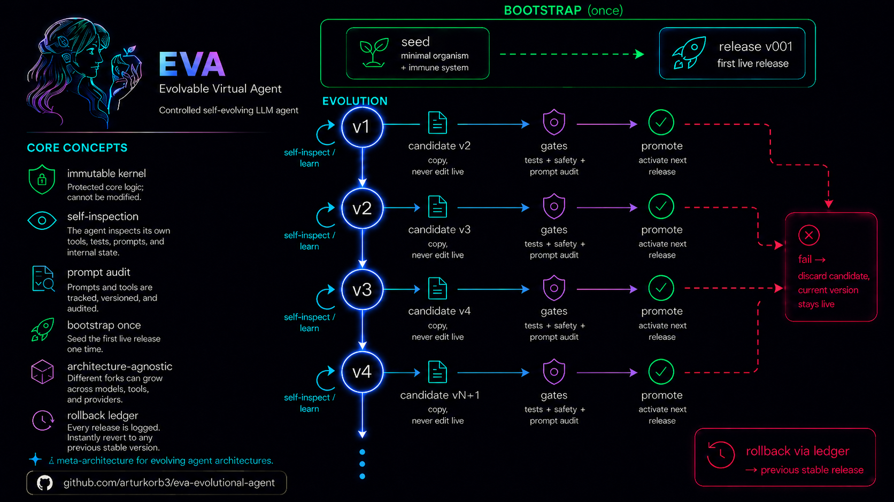

<p align="center">
  
</p>

<h1 align="center">EVA — <b>E</b>volvable <b>V</b>irtual <b>A</b>gent</h1>

<p align="center">
  <a href="https://github.com/arturkorb3/eva-evolutional-agent/actions/workflows/ci.yml"></a>
  
  
  
  
</p>

<p align="center">
  <a href="https://arturkorb3.github.io/eva-evolutional-agent/"><b>Documentation & deep dive&nbsp;→</b></a>
</p>

> [!WARNING]
> **Experimental and self-modifying.** EVA runs shell commands and rewrites its own
> source code. **Only ever run it inside the provided Docker sandbox.**

EVA is a small, self-evolving LLM agent. A tiny **immutable kernel** boots a single
**seed** release; from there EVA rewrites, tests, and promotes new versions of
*itself* inside a hardened Docker sandbox — every self-change a **gated, reversible**
step, never live surgery on a running system.

## Not an agent framework — a meta-architecture

EVA doesn't ship a finished agent architecture. It ships the **mechanism to grow one
under control**: seed → candidate → gates → promote → ledger → rollback. Everything
you'd call "the agent" — loop, tools, adapters, memory, self-model, TUI — is just
*generation 0*, and EVA evolves it. Two different uses grow two different EVAs.

| | Most agent frameworks | EVA |
|---|---|---|
| Architecture | fixed, shipped up front | **evolves through generations** |
| Self-improvement | prompt/config tweaks | rewrites its own **code** as a gated release |
| Safety of self-change | manual / none | test **ratchet** · immutable **kernel gate** · gated **prompt surface** · rollback ledger |
| New capability | you code a plugin | **earned from real usage and friction**, then promoted |

## Core concepts

- **Immutable kernel** — `organism.py` (~900 lines) is baked into the image, out of the
  agent's reach. It seeds the genome, runs the final gate, keeps the release ledger.
- **Gated evolution** — EVA never edits the running code. It builds a *candidate copy*,
  which must survive the full gate stack (tests, ratchet, smoke, dry-runs, kernel
  constitution, prompt-surface audit — deterministic layers on by default, an optional
  nonce-guarded LLM judge via `EVA_PROMPT_AUDIT=llm`) before it is promoted. Fail → discarded.
- **The ratchet** — a candidate may never *execute* fewer checks than the live release.
  Capabilities can only grow; guardrails can't silently erode.
- **Generated self-knowledge** — EVA's self-model is derived from the live code on every
  run (anatomy, skills, guarantees, policies). A promotion updates its self-image
  automatically; self-knowledge and reality can't drift apart.
- **Friction-driven growth** — failed commands, errors, and recurring capability gaps
  land in a persistent backlog. New skills are *earned from what you actually keep
  asking for*, not designed up front.
- **Lived experience** — every session ends as a compact episode in a cross-session
  memory (recalled on demand, auto-surfaced on related tasks), plus a lessons journal
  and vitals. Evolved skills persist too: even system packages survive the throwaway
  container via a kernel-provisioned manifest.
- **Contained, not "safe"** — hardened container (non-root, read-only rootfs, caps
  dropped, resource limits), **key-guard sidecar** (on by default) so the API key never
  enters EVA's container, opt-in prompt-injection spotlighting, human-in-the-loop approvals.

**EVA improving itself** — a real, unedited 3-minute session: asked to *"give yourself a
soul"*, EVA creates a candidate, writes `soul.md`, protects it with a new ratchet check,
passes 87/87 checks and both gates — and is promoted to **v002**:

<p align="center">
  
</p>

<p align="center">
  <a href="https://arturkorb3.github.io/eva-evolutional-agent/#evolution">▶ Watch it interactively</a>
  (crisp text, jump between milestones with <code>[</code>/<code>]</code>)
</p>

There's a second recorded session on the page: EVA **evolves a Playwright browser skill**
from scratch — installs the stack, hits a real gate failure, debugs it, passes 122 checks
and promotes to a new release whose system deps persist across containers.
<a href="https://arturkorb3.github.io/eva-evolutional-agent/#evolution">▶ Watch the browser-skill evolution</a>

## Quickstart

Prerequisites: Docker (Engine + Compose v2) running — `docker compose version` to verify.

One-line install (clones to `~/eva`, puts `eva` on PATH, offers to build the image):

```bash
# Linux / macOS
curl -fsSL https://raw.githubusercontent.com/arturkorb3/eva-evolutional-agent/main/install.sh | bash
```

```powershell
# Windows (PowerShell)
iex (irm https://raw.githubusercontent.com/arturkorb3/eva-evolutional-agent/main/install.ps1)
```

Or from a manual clone: `.\run.ps1 install` (Linux/macOS: `./run.sh install`). Then:

```powershell
eva                     # first run: a short wizard sets up provider/model/key, then chat
```

Just talk to EVA in plain language; `/help` lists in-chat commands. From your shell:

```powershell
eva improve                        # directed self-change - describe the task in the chat
eva evolve 3 --yes --allow-shell   # autonomous (Docker contains it)
eva work resume                    # pick up your last work session (each mode: <mode> resume)
eva changes                        # what changed per promotion: reason, files, checks (--all · --diff [file])
eva status  ·  eva rollback  ·  eva help    # ledger · step back · everything else
```

Works the same on Windows (PowerShell) and Linux/macOS (bash/zsh). The core is
**provider-neutral**: any OpenAI-compatible endpoint (OpenAI, Ollama, LM Studio, vLLM,
OpenRouter, …) or Anthropic Claude — pick it in `.env`.

## Learn more

The full deep dive lives on the **[project page](https://arturkorb3.github.io/eva-evolutional-agent/)**:
the evolution loop in detail, the gate stack and the kernel constitution, the four modes,
self-inspection, the security architecture (sandbox tiers, key-guard, prompt audit),
component map, and the honest limitations.

## License

[MIT](LICENSE). Have fun, be careful, and don't run it outside the sandbox.
